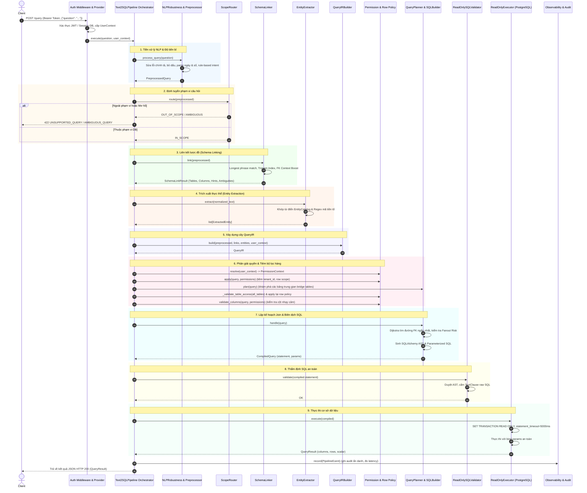

# Tài liệu Kỹ thuật Toàn diện: Kiến trúc, Modules, Luồng Xử lý và Thuật toán trong Advance-Text2SQL

> **Dự án**: Advance-Text2SQL  
> **Đặc tả**: Vietnamese Text2SQL without LLMs (Chuyển đổi ngôn ngữ tự nhiên tiếng Việt sang SQL chuyên biệt cho ERP/Doanh nghiệp, hoàn toàn không sử dụng LLM).  
> **Nguyên tắc cốt lõi**: Tất định (Deterministic), Không đoán mò (Zero-guess), Thất bại an toàn (Fail-closed), Bảo mật đa tầng (Multi-tier RBAC/ABAC), Tham số hóa tuyệt đối (100% Parameterized AST).

---

## Mục lục
1. [Triết lý Kiến trúc & Nguyên tắc Hoạt động](#1-triết-lý-kiến-trúc--nguyên-tắc-hoạt-động)
2. [Bảng Kê Thư viện & Công nghệ Sử dụng](#2-bảng-kê-thư-viện--công-nghệ-sử-dụng)
3. [Danh mục Chi tiết Modules, Classes, Functions & Features](#3-danh-mục-chi-tiết-modules-classes-functions--features)
   - [3.1. Cấu hình & Khởi chạy (Config & Startup)](#31-cấu-hình--khởi-chạy-config--startup)
   - [3.2. Tầng API, Routing & Xử lý Lỗi (API Layer)](#32-tầng-api-routing--xử-lý-lỗi-api-layer)
   - [3.3. Tầng Xác thực & Quản lý Phiên (Authentication & IAM)](#33-tầng-xác-thực--quản-lý-phiên-authentication--iam)
   - [3.4. Tầng Xử lý Ngôn ngữ Tự nhiên tiếng Việt (Vietnamese NLP Engine)](#34-tầng-xử-lý-ngôn-ngữ-tự-nhiên-tiếng-việt-vietnamese-nlp-engine)
   - [3.5. Tầng Siêu dữ liệu & Liên kết Lược đồ (Schema Metadata & Linking)](#35-tầng-siêu-dữ-liệu--liên-kết-lược-đồ-schema-metadata--linking)
   - [3.6. Tầng Kiểm soát Phân quyền & Bảo mật (Permissions & Policies)](#36-tầng-kiểm-soát-phân-quyền--bảo-mật-permissions--policies)
   - [3.7. Tầng Lập kế hoạch & Biên dịch SQL (Query Planning & SQL Compilation)](#37-tầng-lập-kế-hoạch--biên-dịch-sql-query-planning--sql-compilation)
   - [3.8. Tầng Thẩm định & Thực thi Cơ sở dữ liệu (Validation & Execution)](#38-tầng-thẩm-định--thực-thi-cơ-sở-dữ-liệu-validation--execution)
   - [3.9. Tầng Quan sát & Giám sát An toàn (Privacy-Safe Observability)](#39-tầng-quan-sát--giám-sát-an-toàn-privacy-safe-observability)
   - [3.10. Mô hình Dữ liệu Chia sẻ, Enums & Ngoại lệ (Shared Models & Exceptions)](#310-mô-hình-dữ-liệu-chia-sẻ-enums--ngoại-lệ-shared-models--exceptions)
4. [Sơ đồ & Luồng Xử lý Toàn trình (End-to-End Pipeline Workflow)](#4-sơ-đồ--luồng-xử-lý-toàn-trình-end-to-end-pipeline-workflow)
5. [Phân tích Chuyên sâu các Thuật toán Cốt lõi](#5-phân-tích-chuyên-sâu-các-thuật-toán-cốt-lõi)
   - [5.1. Chuẩn hóa Văn bản & Tách Dấu tiếng Việt (Unicode Accent Stripping)](#51-chuẩn-hóa-văn-bản--tách-dấu-tiếng-việt-unicode-accent-stripping)
   - [5.2. Đo Khoảng cách Chỉnh sửa Ký tự (Levenshtein Distance)](#52-đo-khoảng-cách-chỉnh-sửa-ký-tự-levenshtein-distance)
   - [5.3. Khớp và Xếp hạng Ứng viên Lược đồ (Inverted Index, Trigram & Fuzzy Scoring)](#53-khớp-và-xếp-hạng-ứng-viên-lược-đồ-inverted-index-trigram--fuzzy-scoring)
   - [5.4. Tìm Đường nối Khóa ngoại Tối ưu (Dijkstra's Shortest Path with Role Weights)](#54-tìm-đường-nối-khóa-ngoại-tối-ưu-dijkstras-shortest-path-with-role-weights)
   - [5.5. Hóa giải Rủi ro Bùng nổ Dữ liệu Phép Join (Fanout Risk & Pre-aggregation)](#55-hóa-giải-rủi-ro-bùng-nổ-dữ-liệu-phép-join-fanout-risk--pre-aggregation)
   - [5.6. Biên dịch Cây Cú pháp AST & Thẩm định Chống SQL Injection](#56-biên-dịch-cây-cú-pháp-ast--thẩm-định-chống-sql-injection)
6. [Ma trận Mã Lỗi và Chiến lược Xử lý Ngoại lệ (Error Matrix)](#6-ma-trận-mã-lỗi-và-chiến-lược-xử-lý-ngoại-lệ-error-matrix)

---

## 1. Triết lý Kiến trúc & Nguyên tắc Hoạt động

Khác với các hệ sinh thái Text-to-SQL sử dụng LLM (vốn gặp vấn đề lớn về độ trễ, chi phí token, hallucination sinh sai tên bảng/cột và nguy cơ lộ dữ liệu nhạy cảm), **Advance-Text2SQL** được thiết kế như một **hệ thống chuyên gia tất định (Deterministic Expert System)**:

1. **Deterministic Pipeline (Luồng xử lý tất định)**: Cùng một câu hỏi tự nhiên và cùng một ngữ cảnh người dùng sẽ luôn sinh ra một kế hoạch SQL và bộ tham số hoàn toàn đồng nhất.
2. **Zero-guessing (Không suy đoán mò mẫm)**: Nếu câu hỏi mơ hồ, thiếu thực thể hoặc có nhiều hơn một đường nối bảng bằng điểm nhau, hệ thống dừng lại ngay lập tức và yêu cầu làm rõ, không tự chọn ngẫu nhiên.
3. **Fail-closed (Đóng an toàn)**: Mọi lỗi vi phạm phân quyền, vi phạm schema, hoặc rủi ro sai lệch dữ liệu tài chính (fanout) đều khiến truy vấn dừng lại với các mã lỗi HTTP có kiểm soát (`403 FORBIDDEN`, `422 UNPROCESSABLE_CONTENT`, `503 SERVICE_UNAVAILABLE`).
4. **Separation of Concerns (Phân tách trách nhiệm)**:
   - Tầng NLP chỉ phân tích ngôn ngữ, không quyết định quyền và không sinh SQL.
   - Tầng Schema Linker chỉ cung cấp bằng chứng ứng viên, không chọn kế hoạch Join.
   - Tầng Permission tiêm bộ lọc hàng/cột từ danh tính được xác thực, không tin tưởng body client.
   - Tầng Planner/Builder chỉ làm việc với đối tượng trừu tượng đã xác thực qua siêu dữ liệu.
   - Tầng Execution chỉ thực thi truy vấn `READ ONLY` với timeout bảo vệ tài nguyên máy chủ.

---

## 2. Bảng Kê Thư viện & Công nghệ Sử dụng

### 2.1. Thư viện Bên thứ ba (Third-party Packages)
| Thư viện | Phiên bản | Vai trò & Ứng dụng trong Hệ thống |
| :--- | :--- | :--- |
| **`fastapi`** | `>=0.115,<1` | Framework Web API; định tuyến endpoint, xử lý Dependency Injection (`Depends`), tự động sinh OpenAPI spec. |
| **`uvicorn[standard]`** | `>=0.30,<1` | Máy chủ web ASGI hiệu năng cao phục vụ ứng dụng FastAPI. |
| **`sqlalchemy`** | `>=2.0,<3` | Sử dụng **SQLAlchemy Core**: biểu diễn cây cú pháp trừu tượng (`Select`, `Join`, `column`, `table`, `bindparam`), kiểm soát dialect PostgreSQL và quản lý Engine/Connection pool. |
| **`psycopg[binary]`** | `>=3.2,<4` | Driver kết nối PostgreSQL 3 hiệu năng cao, hỗ trợ binding tham số nhị phân an toàn. |
| **`pydantic`** | `>=2.9,<3` | Khai báo và thẩm định cấu trúc dữ liệu nghiêm ngặt cho toàn bộ model đầu vào/đầu ra và trạng thái trung gian (`BaseModel`, `ConfigDict(extra='forbid')`). |
| **`pydantic-settings`** | `>=2.5,<3` | Đọc và kiểm tra tính hợp lệ của biến môi trường hệ thống và file cấu hình `.env`. |
| **`PyYAML`** | `>=6,<7` | Parser file siêu dữ liệu [`schema/schema_spec.yaml`](file:///c:/Workspace/Advance-Text2SQL/schema/schema_spec.yaml) và từ điển alias [`schema/aliases.yaml`](file:///c:/Workspace/Advance-Text2SQL/schema/aliases.yaml). |
| **`python-jose`** | `>=3.3,<4` | Ký, sinh và thẩm định tính hợp lệ của JWT access token và refresh token theo chuẩn `HS256`. |
| **`pytest`** | `>=8,<10` | Framework chạy tự động toàn bộ Unit Tests, Integration Tests và Regression Benchmarks. |
| **`httpx`** | `>=0.27,<1` | Client HTTP không đồng bộ và đồng bộ dùng trong kiểm thử API tích hợp. |

### 2.2. Thư viện Chuẩn Python (Standard Libraries)
* **`unicodedata`**: Bóc tách dạng chuẩn hóa Unicode (NFC/NFD) và phát hiện các ký tự dấu thanh/dấu mũ combining characters tiếng Việt.
* **`re`**: Bộ máy biểu thức chính quy (Regex) phân tích cú pháp ngày tháng, nhận dạng số tiền/phần trăm, định danh mã thực thể và phân loại ý định.
* **`datetime`, `time`**: Tính toán các mốc lịch, khoảng thời gian nửa khoảng `[start, end)` và đo lường độ trễ từng chặng bằng `time.perf_counter()`.
* **`decimal.Decimal`**: Đảm bảo độ chính xác tuyệt đối khi đọc và xử lý các giá trị tiền tệ, doanh thu, tránh sai số dấu phẩy động của kiểu float.
* **`heapq`**: Cấu trúc hàng đợi ưu tiên (Min-Heap) để cài đặt thuật toán Dijkstra tìm đường đi ngắn nhất giữa các bảng.
* **`difflib.SequenceMatcher`**: Thuật toán so khớp xấp xỉ Ratcliff-Obershelp dùng trong fuzzy string matching cho các từ gõ sai.
* **`collections.defaultdict`, `collections.Counter`**: Quản lý danh sách kề đồ thị và tổng hợp tần suất thống kê.
* **`hashlib` & `secrets`**: Băm SHA-256 session token và sinh chuỗi token bảo mật ngẫu nhiên.
* **`uuid.uuid4`**: Sinh định danh duy nhất cho từng phiên truy vấn (`query_id`) và token JWT (`jti`).
* **`abc.ABC`, `abc.abstractmethod`**: Định nghĩa các giao diện trừu tượng chuẩn mực cho từng thành phần trong hệ thống.

---

## 3. Danh mục Chi tiết Modules, Classes, Functions & Features

### 3.1. Cấu hình & Khởi chạy (Config & Startup)
* **[`src/config.py`](file:///c:/Workspace/Advance-Text2SQL/src/config.py)**:
  * [`Settings`](file:///c:/Workspace/Advance-Text2SQL/src/config.py#L8): Lớp quản lý cấu hình hệ thống kế thừa từ `BaseSettings`. Các trường quan trọng:
    * `query_max_limit` (mặc định 1000): Giới hạn dòng tối đa mà API cho phép trả về.
    * `query_timeout_ms` (mặc định 5000ms): Thời gian ngắt truy vấn tại PostgreSQL.
    * `database_connect_timeout_s` (mặc định 3s): Thời gian tối đa chờ kết nối database.
    * `auth_secret_key`: Khóa bí mật ký JWT, bắt buộc độ dài $\ge 32$ ký tự.
    * `database_url`: Thuộc tính sinh kết nối `postgresql+psycopg://...`.
  * [`get_settings()`](file:///c:/Workspace/Advance-Text2SQL/src/config.py#L52): Hàm trả về instance cấu hình singleton có cache (`@lru_cache`).
* **[`src/main.py`](file:///c:/Workspace/Advance-Text2SQL/src/main.py)**:
  * Điểm khởi động ứng dụng FastAPI. Đăng ký middleware [`AuthenticationMiddleware`](file:///c:/Workspace/Advance-Text2SQL/src/auth/middleware.py#L24), thiết lập CORS và gắn các router chức năng.

---

### 3.2. Tầng API, Routing & Xử lý Lỗi (API Layer)
* **[`src/api/dependencies.py`](file:///c:/Workspace/Advance-Text2SQL/src/api/dependencies.py)**:
  * [`get_authentication_provider()`](file:///c:/Workspace/Advance-Text2SQL/src/api/dependencies.py#L16): Dependency cung cấp provider xác thực (mặc định [`DefaultAuthenticationProvider`](file:///c:/Workspace/Advance-Text2SQL/src/auth/provider.py#L92)).
  * [`get_authenticated_user(request)`](file:///c:/Workspace/Advance-Text2SQL/src/api/dependencies.py#L21): Trích xuất [`AuthenticatedIdentity`](file:///c:/Workspace/Advance-Text2SQL/src/auth/models.py#L8) từ `request.state.identity`, chuyển thành [`UserContext`](file:///c:/Workspace/Advance-Text2SQL/src/shared/models.py#L28). Bắt buộc phải có danh tính hợp lệ, nếu không quăng `HTTP 401 UNAUTHORIZED`.
  * [`require_observability_admin(user)`](file:///c:/Workspace/Advance-Text2SQL/src/api/dependencies.py#L43): Bảo vệ endpoint giám sát, chỉ cho phép role `admin` hoặc `superuser`.
* **[`src/api/errors.py`](file:///c:/Workspace/Advance-Text2SQL/src/api/errors.py)**:
  * [`error_response(result)`](file:///c:/Workspace/Advance-Text2SQL/src/api/errors.py#L33): Chuyển đổi đối tượng [`QueryResult`](file:///c:/Workspace/Advance-Text2SQL/src/shared/models.py#L98) thất bại thành phản hồi `JSONResponse` chuẩn với mã HTTP tương ứng:
    * `PERMISSION_DENIED` $\to$ `HTTP 403 FORBIDDEN`.
    * `AMBIGUOUS_QUERY`, `UNSUPPORTED_QUERY`, `INVALID_QUERY_IR`, `MISSING_ENTITY`, `SQL_VALIDATION_ERROR` $\to$ `HTTP 422 UNPROCESSABLE_CONTENT`.
    * `SQL_EXECUTION_ERROR` $\to$ `HTTP 503 SERVICE_UNAVAILABLE`.
  * [`service_unavailable_response()`](file:///c:/Workspace/Advance-Text2SQL/src/api/errors.py#L19): Phản hồi lỗi 503 khi CSDL không phản hồi.
* **[`src/api/routes/`](file:///c:/Workspace/Advance-Text2SQL/src/api/routes)**:
  * [`query.py`](file:///c:/Workspace/Advance-Text2SQL/src/api/routes/query.py): Endpoint `POST /query` nhận [`QueryRequest`](file:///c:/Workspace/Advance-Text2SQL/src/shared/models.py#L139), chuyển tới [`Text2SQLPipeline.execute()`](file:///c:/Workspace/Advance-Text2SQL/src/pipeline/orchestrator.py#L70).
  * [`auth.py`](file:///c:/Workspace/Advance-Text2SQL/src/api/routes/auth.py): Các endpoint `POST /auth/login`, `POST /auth/refresh`, `POST /auth/logout`, `GET /auth/me`.
  * [`health.py`](file:///c:/Workspace/Advance-Text2SQL/src/api/routes/health.py): `GET /health` (kiểm tra tiến trình sống) và `GET /health/ready` (chạy `SELECT 1` kiểm tra kết nối PostgreSQL).
  * [`observability.py`](file:///c:/Workspace/Advance-Text2SQL/src/api/routes/observability.py): `GET /observability/summary` trả về báo cáo tổng hợp hiệu năng và phân loại lỗi.

---

### 3.3. Tầng Xác thực & Quản lý Phiên (Authentication & IAM)
* **[`src/auth/models.py`](file:///c:/Workspace/Advance-Text2SQL/src/auth/models.py)**:
  * [`AuthenticatedIdentity`](file:///c:/Workspace/Advance-Text2SQL/src/auth/models.py#L8): Đối tượng bất biến (`frozen=True`) đại diện cho người dùng đã được xác thực an toàn: `user_id`, `role`, `tenant_id`, `employee_id`, `department_id`, `branch_id`, `team_id`.
  * Các DTOs: [`LoginRequest`](file:///c:/Workspace/Advance-Text2SQL/src/auth/models.py#L51), [`RefreshRequest`](file:///c:/Workspace/Advance-Text2SQL/src/auth/models.py#L60), [`LogoutRequest`](file:///c:/Workspace/Advance-Text2SQL/src/auth/models.py#L68), [`TokenResponse`](file:///c:/Workspace/Advance-Text2SQL/src/auth/models.py#L76), [`IdentityResponse`](file:///c:/Workspace/Advance-Text2SQL/src/auth/models.py#L85).
* **[`src/auth/tokens.py`](file:///c:/Workspace/Advance-Text2SQL/src/auth/tokens.py)**:
  * [`create_access_token()`](file:///c:/Workspace/Advance-Text2SQL/src/auth/tokens.py#L46), [`create_refresh_token()`](file:///c:/Workspace/Advance-Text2SQL/src/auth/tokens.py#L84): Tạo JWT kèm payload danh tính, hạn dùng (`exp`) và ID token ngẫu nhiên (`jti`).
  * [`decode_access_token()`](file:///c:/Workspace/Advance-Text2SQL/src/auth/tokens.py#L117), [`decode_refresh_token()`](file:///c:/Workspace/Advance-Text2SQL/src/auth/tokens.py#L159): Giải mã và kiểm tra chữ ký, kiểm tra blacklist `_REVOKED_JTIS`.
  * [`revoke_token()`](file:///c:/Workspace/Advance-Text2SQL/src/auth/tokens.py#L17), [`is_token_revoked()`](file:///c:/Workspace/Advance-Text2SQL/src/auth/tokens.py#L34): Quản lý cơ chế thu hồi token tức thì.
* **[`src/auth/provider.py`](file:///c:/Workspace/Advance-Text2SQL/src/auth/provider.py)**:
  * [`AuthenticationProvider`](file:///c:/Workspace/Advance-Text2SQL/src/auth/provider.py#L21): Interface trừu tượng xác thực.
  * [`DefaultAuthenticationProvider`](file:///c:/Workspace/Advance-Text2SQL/src/auth/provider.py#L92): Hiện thực hóa xác thực qua PostgreSQL schema `iam`:
    * Kiểm tra mật khẩu bằng hàm băm mã hóa CSDL: `u.password_hash = crypt(:password, u.password_hash)`.
    * Lưu và quản lý phiên băm SHA-256 trong bảng `iam.login_sessions`.
    * Chuyển đổi role người dùng sang quyền hạn tương ứng (`admin`, `hr_manager`, `finance_manager`, `employee`, v.v.).
* **[`src/auth/middleware.py`](file:///c:/Workspace/Advance-Text2SQL/src/auth/middleware.py)**:
  * [`AuthenticationMiddleware`](file:///c:/Workspace/Advance-Text2SQL/src/auth/middleware.py#L24): Bắt mọi request tới các endpoint bảo vệ (ngoại trừ whitelist `/health`, `/auth/login`, `/docs`, v.v.), đọc `Authorization: Bearer <token>`, giải mã và đưa danh tính vào `request.state.identity`.

---

### 3.4. Tầng Xử lý Ngôn ngữ Tự nhiên tiếng Việt (Vietnamese NLP Engine)
* **[`src/nlp/normalizer.py`](file:///c:/Workspace/Advance-Text2SQL/src/nlp/normalizer.py)**:
  * [`strip_accents(text)`](file:///c:/Workspace/Advance-Text2SQL/src/nlp/normalizer.py#L10): Loại bỏ dấu tiếng Việt chuẩn xác bằng cách đưa về Unicode NFD, lọc combining marks và ánh xạ `đ/Đ` $\to$ `d/D`.
  * [`Normalizer.normalize(text)`](file:///c:/Workspace/Advance-Text2SQL/src/nlp/normalizer.py#L18): Đưa về Unicode NFC, chuyển chữ thường, thay thế ngoặc kép nghiêng/dấu gạch ngang typography, gộp khoảng trắng thừa và rút gọn dấu chấm câu trùng lặp (`...` $\to$ `.`).
* **[`src/nlp/semantic_normalizer.py`](file:///c:/Workspace/Advance-Text2SQL/src/nlp/semantic_normalizer.py)**:
  * [`BusinessConcept`](file:///c:/Workspace/Advance-Text2SQL/src/nlp/semantic_normalizer.py#L12) & hằng số `BUSINESS_CONCEPTS`: Khai báo 22 thực thể ERP chuẩn (`employee`, `department`, `vendor_bill`, `sales_order`, `stock_transfer`, v.v.).
  * [`SemanticNormalizer`](file:///c:/Workspace/Advance-Text2SQL/src/nlp/semantic_normalizer.py#L70): Chuẩn hóa từ viết tắt (`nv` $\to$ `nhân viên`, `kh` $\to$ `khách hàng`, `pb` $\to$ `phòng ban`, `dt` $\to$ `doanh thu`, `ncc` $\to$ `nhà cung cấp`, `po` $\to$ `purchase order`) và chuyển ngữ nghĩa các cụm từ đếm số lượng người ("headcount", "số người", "mấy người") thành "bao nhiêu nhân viên".
* **[`src/nlp/date_parser.py`](file:///c:/Workspace/Advance-Text2SQL/src/nlp/date_parser.py)**:
  * [`DateParser.parse(text, reference_date)`](file:///c:/Workspace/Advance-Text2SQL/src/nlp/date_parser.py#L65): Bóc tách biểu thức thời gian tiếng Việt và tính toán khoảng thời gian nửa khoảng `[start, end)`:
    * Định dạng cụ thể: `YYYY-MM-DD`, `DD/MM/YYYY`, `ngày ... tháng ... năm ...`.
    * Định dạng tương đối: "hôm nay", "hôm qua", "tuần này", "tuần trước", "tháng này", "tháng trước", "quý 1/2/3/4", "năm nay", "năm trước", "trong N năm gần đây", "từ năm A đến năm B".
* **[`src/nlp/number_parser.py`](file:///c:/Workspace/Advance-Text2SQL/src/nlp/number_parser.py)**:
  * [`NumberParser.parse(text)`](file:///c:/Workspace/Advance-Text2SQL/src/nlp/number_parser.py#L33): Phân tích số nguyên/thập phân chính xác bằng `decimal.Decimal`:
    * Xử lý linh hoạt dấu phẩy/chấm nghìn và thập phân.
    * Gán semantic type: `number` (số thuần), `percentage` (phần trăm: `%`), `money` (tiền tệ: `vnd`, `đồng`, `₫`).
    * Áp dụng độ phóng đại đơn vị lớn: `nghìn/ngàn` ($\times 10^3$), `triệu` ($\times 10^6$), `tỷ/ti` ($\times 10^9$).
* **[`src/nlp/intent_classifier.py`](file:///c:/Workspace/Advance-Text2SQL/src/nlp/intent_classifier.py)**:
  * [`IntentClassifier`](file:///c:/Workspace/Advance-Text2SQL/src/nlp/intent_classifier.py#L13): Interface cơ sở.
  * [`RuleBasedIntentClassifier`](file:///c:/Workspace/Advance-Text2SQL/src/nlp/intent_classifier.py#L20): Phân loại ý định tất định bằng thứ tự ưu tiên Regex nghiêm ngặt:
    1. `TREND`: Xu hướng ("thay đổi thế nào", "biến động", "qua các tháng/năm").
    2. `COMPARISON`: So sánh ("so sánh", "đối chiếu", "khác nhau thế nào").
    3. `TOP_N`: Thứ hạng ("top", "bán chạy nhất", "cao nhất", "thấp nhất").
    4. `AVERAGE`: Trung bình ("trung bình", "bình quân").
    5. `REVENUE`: Doanh thu ("doanh thu", "doanh số", "tổng thu").
    6. `COUNT`: Đếm ("có bao nhiêu", "số lượng", "đếm", "headcount").
    7. `SUM`: Tổng cộng tiền/chi phí ("tổng chi phí", "tổng tiền", "tổng giá trị").
    8. `DETAIL`: Chi tiết bản ghi ("thông tin", "chi tiết", "hồ sơ").
    9. `LIST`: Liệt kê danh sách ("danh sách", "liệt kê", "những", "các").
    10. `UNKNOWN`: Dự phòng nếu không khớp quy tắc nào.
* **[`src/nlp/entity_catalog.py`](file:///c:/Workspace/Advance-Text2SQL/src/nlp/entity_catalog.py)**:
  * [`CatalogEntry`](file:///c:/Workspace/Advance-Text2SQL/src/nlp/entity_catalog.py#L18) & [`CatalogMatch`](file:///c:/Workspace/Advance-Text2SQL/src/nlp/entity_catalog.py#L26).
  * [`EntityCatalog`](file:///c:/Workspace/Advance-Text2SQL/src/nlp/entity_catalog.py#L34): Danh mục từ điển thực thể giá trị kinh doanh trong bộ nhớ:
    * Chi nhánh: "Hồ Chí Minh" (`hcm`, `ho chi minh`), "Hà Nội".
    * Phòng ban: "Kinh doanh" (`sales`), "Nhân sự" (`hr`), "Kế toán" (`accounting`).
    * Hạng khách hàng: "VIP", "STANDARD", "SILVER", "GOLD", "PLATINUM".
    * Trạng thái: "COMPLETED", "PENDING", "CANCELLED", "ACTIVE", "INACTIVE".
    * Độ ưu tiên: "LOW", "NORMAL", "HIGH", "URGENT".
* **[`src/nlp/entity_extractor.py`](file:///c:/Workspace/Advance-Text2SQL/src/nlp/entity_extractor.py)**:
  * [`ExtractedEntity`](file:///c:/Workspace/Advance-Text2SQL/src/nlp/entity_extractor.py#L13).
  * [`DeterministicEntityExtractor`](file:///c:/Workspace/Advance-Text2SQL/src/nlp/entity_extractor.py#L40): Trích xuất thực thể bằng so khớp từ điển `EntityCatalog` và nhận diện mã nghiệp vụ có tiền tố (`emp001`, `so002`, `inv003`, `cust004`) hoặc có nhãn ("mã chi nhánh: CN1", "mã phòng ban: PB02").
* **[`src/nlp/scope_router.py`](file:///c:/Workspace/Advance-Text2SQL/src/nlp/scope_router.py)**:
  * [`ScopeRouter.route(text)`](file:///c:/Workspace/Advance-Text2SQL/src/nlp/scope_router.py#L57): Phân loại phạm vi câu hỏi thành 3 trạng thái:
    * `IN_SCOPE`: Chứa hành động dữ liệu + thực thể nghiệp vụ/mã định danh/trạng thái/thời gian.
    * `OUT_OF_SCOPE`: Câu hỏi phi dữ liệu (thời tiết, công thức, bài hát, dịch thuật, giải thích).
    * `AMBIGUOUS`: Câu hỏi mơ hồ hoặc không đủ ngữ cảnh CSDL.
* **[`src/nlp/robustness.py`](file:///c:/Workspace/Advance-Text2SQL/src/nlp/robustness.py)**:
  * [`compute_levenshtein_distance()`](file:///c:/Workspace/Advance-Text2SQL/src/nlp/robustness.py#L46): Tính khoảng cách chỉnh sửa giữa 2 chuỗi.
  * [`NLPRobustnessProcessor`](file:///c:/Workspace/Advance-Text2SQL/src/nlp/robustness.py#L66): Bộ xử lý tổng hợp độ bền vững, sửa lỗi gõ sai và điều phối chuẩn hóa, bóc tách ngày/số và phân loại ý định thành [`PreprocessedQuery`](file:///c:/Workspace/Advance-Text2SQL/src/shared/models.py#L149).

---

### 3.5. Tầng Siêu dữ liệu & Liên kết Lược đồ (Schema Metadata & Linking)
* **[`src/schema/registry.py`](file:///c:/Workspace/Advance-Text2SQL/src/schema/registry.py)**:
  * [`SchemaRegistry`](file:///c:/Workspace/Advance-Text2SQL/src/schema/registry.py#L44): Nguồn chân lý siêu dữ liệu (Metadata Source of Truth) trong bộ nhớ, load từ [`schema/schema_spec.yaml`](file:///c:/Workspace/Advance-Text2SQL/schema/schema_spec.yaml) (100 bảng, 855 cột, 11 schemas).
  * [`resolve_table(name)`](file:///c:/Workspace/Advance-Text2SQL/src/schema/registry.py#L99), [`resolve_column(name)`](file:///c:/Workspace/Advance-Text2SQL/src/schema/registry.py#L111): Xác thực và chuẩn hóa tên bảng (`schema.table`) và cột (`schema.table.column`). Ném lỗi nếu định danh sai hoặc trùng lặp không rõ ràng.
* **[`src/schema/relationship_graph.py`](file:///c:/Workspace/Advance-Text2SQL/src/schema/relationship_graph.py)**:
  * [`RelationshipGraph`](file:///c:/Workspace/Advance-Text2SQL/src/schema/relationship_graph.py#L12): Mô hình hóa đồ thị quan hệ khóa ngoại giữa 100 bảng.
  * [`find_relationship_path(source, target, preferred_edges)`](file:///c:/Workspace/Advance-Text2SQL/src/schema/relationship_graph.py#L46): **Thuật toán Dijkstra** tìm đường nối khóa ngoại ngắn nhất:
    * Cạnh thường: cost = 10.
    * Cạnh có hint nghiệp vụ xác thực: cost = 6.
    * Cạnh liên kết qua trường đa người thuê (`tenant_id`): cost = 14 (hạn chế đi tắt qua tenant).
    * Báo lỗi [`AmbiguousJoinPathError`](file:///c:/Workspace/Advance-Text2SQL/src/shared/exceptions.py#L50) nếu có nhiều hơn 1 đường nối cùng chi phí tối ưu (fail-closed).
* **[`src/schema/linker.py`](file:///c:/Workspace/Advance-Text2SQL/src/schema/linker.py)**:
  * [`RankingConfig`](file:///c:/Workspace/Advance-Text2SQL/src/schema/linker.py#L23): Cấu hình trọng số và điểm phạt xếp hạng ứng viên.
  * [`SchemaLinker`](file:///c:/Workspace/Advance-Text2SQL/src/schema/linker.py#L189): Ánh xạ từ khóa câu hỏi sang các ứng viên schema:
    * Xây dựng chỉ mục đảo Inverted Index (Token Index và Trigram Index) từ [`schema/aliases.yaml`](file:///c:/Workspace/Advance-Text2SQL/schema/aliases.yaml).
    * Áp dụng so khớp cụm từ dài nhất (longest phrase match), Jaccard token overlap và Ratcliff-Obershelp fuzzy ratio.
    * Tăng điểm ngữ cảnh (Context Boost) và điểm láng giềng đồ thị (Relationship Boost).
    * Phát hiện từ mơ hồ (`ambiguous_terms`) khi chênh lệch điểm số giữa 2 lựa chọn hàng đầu $\le$ `ambiguity_margin` (0.015).

---

### 3.6. Tầng Kiểm soát Phân quyền & Bảo mật (Permissions & Policies)
* **[`src/permission/models.py`](file:///c:/Workspace/Advance-Text2SQL/src/permission/models.py)**:
  * [`PermissionContext`](file:///c:/Workspace/Advance-Text2SQL/src/permission/models.py#L7): Kết quả giải quyết phân quyền: `allowed_tables`, `allowed_columns`, `denied_columns`, danh sách `row_filters`, phạm vi `scope` ([`PermissionScope`](file:///c:/Workspace/Advance-Text2SQL/src/shared/enums.py#L44)), và `tenant_id`.
* **[`src/permission/resolver.py`](file:///c:/Workspace/Advance-Text2SQL/src/permission/resolver.py)**:
  * [`DefaultPermissionResolver`](file:///c:/Workspace/Advance-Text2SQL/src/permission/resolver.py#L19): Phân giải quyền hạn dựa theo role:
    * `admin`, `superuser`: Toàn quyền (`allowed_tables=["*"]`).
    * `branch_manager`: Giới hạn phạm vi chi nhánh (`branch_id`).
    * `department_manager`: Giới hạn phạm vi phòng ban (`department_id`).
    * `team_lead`: Giới hạn phạm vi nhóm (`team_id`).
    * `employee`, `self`: Giới hạn bản ghi chính mình (`employee_id`). Lấy khóa chính bảng `hr.employees` một cách tất định từ registry.
* **[`src/permission/column_policy.py`](file:///c:/Workspace/Advance-Text2SQL/src/permission/column_policy.py)**:
  * [`DefaultColumnPolicy`](file:///c:/Workspace/Advance-Text2SQL/src/permission/column_policy.py#L36):
    * Quản lý danh sách cột nhạy cảm [`SENSITIVE_COLUMNS`](file:///c:/Workspace/Advance-Text2SQL/src/permission/column_policy.py#L9): Lương (`base_salary`), tài khoản ngân hàng (`bank_account`), CMND/CCCD (`national_id`), mã số thuế (`tax_code`), mật khẩu (`password_hash`).
    * Chặn ngay lập tức với lỗi [`PermissionDeniedError`](file:///c:/Workspace/Advance-Text2SQL/src/shared/exceptions.py#L9) nếu câu hỏi cố truy cập vào cột bị cấm hoặc cột nhạy cảm mà role chưa được cấp phép tường minh.
* **[`src/permission/row_policy.py`](file:///c:/Workspace/Advance-Text2SQL/src/permission/row_policy.py)**:
  * [`ScopedRowPolicy`](file:///c:/Workspace/Advance-Text2SQL/src/permission/row_policy.py#L19): Tự động tiêm các bộ lọc hàng bảo mật (`source="permission"`) vào `QueryIR`:
    * Tự động gắn điều kiện `tenant_id = :pX` cho tất cả các bảng có cột `tenant_id`.
    * Gắn điều kiện lọc chi nhánh/phòng ban/nhân viên tương ứng với quyền.
    * Với các bảng ở vế phải của phép LEFT JOIN, giữ bộ lọc trong mệnh đề `ON` để không làm mất bản ghi bên trái.

---

### 3.7. Tầng Lập kế hoạch & Biên dịch SQL (Query Planning & SQL Compilation)
* **[`src/query/ir.py`](file:///c:/Workspace/Advance-Text2SQL/src/query/ir.py)**:
  * Khai báo cây đại diện trung gian độc lập: [`QueryIR`](file:///c:/Workspace/Advance-Text2SQL/src/query/ir.py#L192), [`QueryFilter`](file:///c:/Workspace/Advance-Text2SQL/src/query/ir.py#L113), [`SelectItem`](file:///c:/Workspace/Advance-Text2SQL/src/query/ir.py#L136), [`HavingCondition`](file:///c:/Workspace/Advance-Text2SQL/src/query/ir.py#L154), [`OrderBy`](file:///c:/Workspace/Advance-Text2SQL/src/query/ir.py#L165), [`TimeGroup`](file:///c:/Workspace/Advance-Text2SQL/src/query/ir.py#L183), [`TableInstance`](file:///c:/Workspace/Advance-Text2SQL/src/query/ir.py#L21) (quan hệ self-join nhân viên - quản lý), [`PeriodComparison`](file:///c:/Workspace/Advance-Text2SQL/src/query/ir.py#L297) (so sánh 2 kỳ).
* **[`src/query/ir_builder.py`](file:///c:/Workspace/Advance-Text2SQL/src/query/ir_builder.py)**:
  * [`QueryIRBuilder`](file:///c:/Workspace/Advance-Text2SQL/src/query/ir_builder.py#L29): Chuyển hóa kết quả NLP, liên kết schema và thực thể thành đối tượng `QueryIR`. Xử lý cấu trúc ngữ pháp đếm, tính tổng doanh thu, lọc kỳ kinh doanh, xếp hạng TOP-N.
* **[`src/query/join_resolver.py`](file:///c:/Workspace/Advance-Text2SQL/src/query/join_resolver.py)**:
  * [`JoinResolver.resolve()`](file:///c:/Workspace/Advance-Text2SQL/src/query/join_resolver.py#L9): Tổng hợp đường đi ngắn nhất từ bảng gốc tới các bảng đích thành cây khung nối bảng (Rooted Shortest-Path Tree), loại bỏ các cạnh trùng lặp và giữ nguyên các bảng trung gian (bridge tables).
* **[`src/query/planner.py`](file:///c:/Workspace/Advance-Text2SQL/src/query/planner.py)**:
  * [`QueryPlanner`](file:///c:/Workspace/Advance-Text2SQL/src/query/planner.py#L32): Xác thực kiểu dữ liệu cột, xây dựng kế hoạch truy vấn [`QueryPlan`](file:///c:/Workspace/Advance-Text2SQL/src/query/models.py).
  * **Thuật toán xử lý rủi ro bùng nổ dữ liệu (Fanout Risk)** [`_validate_fanout_risk()`](file:///c:/Workspace/Advance-Text2SQL/src/query/planner.py#L65):
    * Phát hiện quan hệ 1-N (One-to-Many) làm nhân bản dòng bảng cha.
    * Tự động chuyển `COUNT(P.col)` thành `COUNT(DISTINCT P.col)`.
    * Tự động tạo subquery tiền gom nhóm (Pre-aggregated Derived Table) cho `SUM`/`AVG` theo Primary Key của bảng cha; nếu không đủ điều kiện an toàn $\to$ ném lỗi [`FanoutRiskError`](file:///c:/Workspace/Advance-Text2SQL/src/shared/exceptions.py#L62).
* **[`src/query/sql_builder.py`](file:///c:/Workspace/Advance-Text2SQL/src/query/sql_builder.py)**:
  * [`SQLBuilder`](file:///c:/Workspace/Advance-Text2SQL/src/query/sql_builder.py#L17): Nhận `QueryPlan`, re-plan chống can thiệp trái phép, sinh câu lệnh SQLAlchemy Core `Select`:
    * Quoted toàn bộ định danh bảng/cột theo chuẩn PostgreSQL (`quoted_name(col, True)`).
    * Tham số hóa 100% giá trị bằng [`bindparam()`](file:///c:/Workspace/Advance-Text2SQL/src/query/sql_builder.py#L3) (`:p0`, `:p1`, ...).
    * Biên dịch subquery derived table an toàn nếu có cờ `pre_aggregate_owner`.
    * Trả về [`CompiledQuery`](file:///c:/Workspace/Advance-Text2SQL/src/query/models.py) gồm câu lệnh SQL dạng chuỗi và đối tượng `Select` cùng từ điển `params`.
* **[`src/query/handlers/`](file:///c:/Workspace/Advance-Text2SQL/src/query/handlers)**:
  * [`basic.py`](file:///c:/Workspace/Advance-Text2SQL/src/query/handlers/basic.py): [`BasicQueryHandler`](file:///c:/Workspace/Advance-Text2SQL/src/query/handlers/basic.py#L11) điểm vào thuận tiện chạy Planner và Builder cho các truy vấn tra cứu, đếm, tính tổng cơ bản.
  * [`complex.py`](file:///c:/Workspace/Advance-Text2SQL/src/query/handlers/complex.py): [`ComplexQueryHandler`](file:///c:/Workspace/Advance-Text2SQL/src/query/handlers/complex.py#L12) mở rộng hỗ trợ GROUP BY đa chiều, HAVING, TOP-K và so sánh 2 kỳ thời gian liên tiếp ([`compare()`](file:///c:/Workspace/Advance-Text2SQL/src/query/handlers/complex.py#L15)).

---

### 3.8. Tầng Thẩm định & Thực thi Cơ sở dữ liệu (Validation & Execution)
* **[`src/validation/sql_validator.py`](file:///c:/Workspace/Advance-Text2SQL/src/validation/sql_validator.py)**:
  * [`ReadOnlySQLValidator`](file:///c:/Workspace/Advance-Text2SQL/src/validation/sql_validator.py#L16):
    * Kiểm tra bắt buộc đối tượng statement phải là instance của `sqlalchemy.sql.Select`.
    * Kiểm tra mệnh đề `FROM` không được rỗng.
    * Sử dụng `visitors.traverse` duyệt toàn bộ cây cú pháp AST: nếu phát hiện bất kỳ node nào là [`TextClause`](file:///c:/Workspace/Advance-Text2SQL/src/validation/sql_validator.py#L4) (chuỗi raw SQL) $\to$ ném lỗi [`SQLValidationError`](file:///c:/Workspace/Advance-Text2SQL/src/shared/exceptions.py#L78) ngay lập tức.
* **[`src/database/session.py`](file:///c:/Workspace/Advance-Text2SQL/src/database/session.py)**:
  * Quản lý kết nối Database qua SQLAlchemy Engine (`create_engine`, `pool_pre_ping=True`).
* **[`src/database/executor.py`](file:///c:/Workspace/Advance-Text2SQL/src/database/executor.py)**:
  * [`ReadOnlyExecutor`](file:///c:/Workspace/Advance-Text2SQL/src/database/executor.py#L12):
    * Mở connection ngắn hạn tới PostgreSQL.
    * Thiết lập giao dịch chỉ đọc và timeout cấp session:
      ```sql
      SET TRANSACTION READ ONLY;
      SET LOCAL statement_timeout = 5000;
      ```
    * Thực thi statement kèm tham số đã bind an toàn. Lấy tối đa `max_rows` (1000) dòng, đánh dấu cờ `truncated=True` nếu vượt quá giới hạn.
    * Trả về kết quả [`QueryResult`](file:///c:/Workspace/Advance-Text2SQL/src/shared/models.py#L98).

---

### 3.9. Tầng Quan sát & Giám sát An toàn (Privacy-Safe Observability)
* **[`src/pipeline/observability.py`](file:///c:/Workspace/Advance-Text2SQL/src/pipeline/observability.py)**:
  * [`PipelineEvent`](file:///c:/Workspace/Advance-Text2SQL/src/pipeline/observability.py#L17): Sự kiện ghi nhận kết thúc: `query_id`, `outcome` (success/failure), `stage` (chặng kết thúc), `duration_ms`, `error_code`, `stage_durations_ms`. **Tuyệt đối không lưu text câu hỏi, user_id, raw SQL hay param**.
  * [`LoggingPipelineObserver`](file:///c:/Workspace/Advance-Text2SQL/src/pipeline/observability.py#L37): Ghi log định dạng JSON phục vụ hệ thống tập trung log (ELK, Datadog).
  * [`PersistedPipelineObserver`](file:///c:/Workspace/Advance-Text2SQL/src/pipeline/observability.py#L47): Lưu trữ an toàn vào bảng `audit.text2sql_query_audits` (giới hạn 10,000 dòng gần nhất) và tổng hợp số liệu thống kê cho dashboard.
* **[`src/pipeline/orchestrator.py`](file:///c:/Workspace/Advance-Text2SQL/src/pipeline/orchestrator.py)**:
  * [`Text2SQLPipeline`](file:///c:/Workspace/Advance-Text2SQL/src/pipeline/orchestrator.py#L37): Điều phối toàn trình tuần tự từ NLP $\to$ Scope Routing $\to$ Schema Linking $\to$ Entity Extraction $\to$ IR $\to$ Permissions $\to$ Planner $\to$ Validator $\to$ Executor $\to$ Observability.

---

### 3.10. Mô hình Dữ liệu Chia sẻ, Enums & Ngoại lệ (Shared Models & Exceptions)
* **[`src/shared/enums.py`](file:///c:/Workspace/Advance-Text2SQL/src/shared/enums.py)**:
  * `Intent`: `LOOKUP`, `AVG`, `COUNT`, `SUM`, `REVENUE`, `TOP_N`, `DETAIL`, `LIST`, `FILTER`, `COMPARISON`, `TREND`, `SELECT`, `UNKNOWN`.
  * `FilterOperator`: `EQ`, `NE`, `GT`, `GTE`, `LT`, `LTE`, `IN`, `LIKE`.
  * `SortDirection`: `ASC`, `DESC`.
  * `Aggregation`: `COUNT`, `SUM`, `AVG`.
  * `PermissionScope`: `GLOBAL`, `BRANCH`, `DEPARTMENT`, `TEAM`, `SELF`.
  * `ScopeDecision`: `IN_SCOPE`, `OUT_OF_SCOPE`, `AMBIGUOUS`.
* **[`src/shared/exceptions.py`](file:///c:/Workspace/Advance-Text2SQL/src/shared/exceptions.py)**:
  * Cây kế thừa ngoại lệ miền: `Text2SQLError` $\to$ `QueryValidationError`, `PermissionDeniedError`, `AuthenticationError`, `ServiceUnavailableError`, `AmbiguousJoinPathError`, `FanoutRiskError`, `UnsupportedQueryError`, `MissingEntityError`, `AmbiguousQueryError`, `SQLValidationError`, `QueryExecutionError`.

---

## 4. Sơ đồ & Luồng Xử lý Toàn trình (End-to-End Pipeline Workflow)

### 4.1. Sơ đồ Trình tự Tuần tự (Sequence Diagram)



---

## 5. Phân tích Chuyên sâu các Thuật toán Cốt lõi

### 5.1. Chuẩn hóa Văn bản & Tách Dấu tiếng Việt (Unicode Accent Stripping)
* **File nguồn**: [`src/nlp/normalizer.py`](file:///c:/Workspace/Advance-Text2SQL/src/nlp/normalizer.py).
* **Vấn đề**: Ký tự tiếng Việt có dấu có thể tồn tại dưới dạng tổ hợp (Decomposed - NFD) hoặc dựng sẵn (Composed - NFC).
* **Cơ chế hoạt động**:
  1. Đưa chuỗi về dạng NFD: Mỗi ký tự có dấu được tách thành ký tự gốc và các combining diacritical marks.
  2. Lọc bỏ toàn bộ ký tự combining bằng kiểm tra `not unicodedata.combining(char)`.
  3. Dịch ký tự đặc biệt tiếng Việt: Dùng bảng dịch `str.maketrans("đĐ", "dD")`.
  4. Đưa văn bản về chữ thường (lowercase), hợp nhất khoảng trắng và chuẩn hóa dấu câu lặp.
* **Công thức toán học**:
  $$\text{strip\_accents}(text) = \text{translate}_{\text{đ}\to\text{d}}\left(\left[c \text{ for } c \in \text{NFD}(text) \text{ if not } \text{combining}(c)\right]\right)$$

---

### 5.2. Đo Khoảng cách Chỉnh sửa Ký tự (Levenshtein Distance)
* **File nguồn**: [`src/nlp/robustness.py`](file:///c:/Workspace/Advance-Text2SQL/src/nlp/robustness.py#L46).
* **Mục đích**: Nhận diện và sửa lỗi gõ sai từ ngữ chuyên ngành (ví dụ: `dnah sach` $\to$ `danh sách`, `khach hnag` $\to$ `khách hàng`).
* **Thuật toán**: Quy hoạch động (Dynamic Programming) với tối ưu hóa bộ nhớ chỉ lưu 2 hàng:
  $$D(i, j) = \begin{cases} 
  \max(i, j) & \text{nếu } \min(i, j) = 0, \\
  \min \begin{cases} 
  D(i-1, j) + 1 \\ 
  D(i, j-1) + 1 \\ 
  D(i-1, j-1) + \mathbb{I}(s_1[i] \neq s_2[j]) 
  \end{cases} & \text{khác}.
  \end{cases}$$
* **Độ phức tạp**: Thời gian $O(|s_1| \times |s_2|)$, không gian $O(\min(|s_1|, |s_2|))$. Giới hạn khoảng cách tối đa $\text{max\_distance} = 2$.

---

### 5.3. Khớp và Xếp hạng Ứng viên Lược đồ (Inverted Index, Trigram & Fuzzy Scoring)
* **File nguồn**: [`src/schema/linker.py`](file:///c:/Workspace/Advance-Text2SQL/src/schema/linker.py).
* **Thuật toán đa tầng**:
  1. **Longest Phrase Matching**: Quét từ cửa sổ từ dài nhất (`max_tokens`) giảm dần về 1. Cụm từ dài hơn bao trùm cụm từ ngắn hơn được ưu tiên giữ lại (`maximal spans`).
  2. **Inverted Token & Trigram Index**:
     - `token_index[word]`: Tập hợp các alias chứa từ đó (đã loại bỏ stop words).
     - `trigram_index[tri]`: Tập hợp các alias chứa cụm 3 ký tự liên tiếp $\text{tri}$.
  3. **Jaccard Token Overlap**:
     $$J(\text{words}, \text{target\_words}) = \frac{|\text{words} \cap \text{target\_words}|}{|\text{words} \cup \text{target\_words}|}$$
     Nếu $J \ge 0.80$, ứng viên được xếp loại `token` match với điểm cơ sở $0.86$.
  4. **Fuzzy String Matching (Ratcliff/Obershelp)**:
     Sử dụng `difflib.SequenceMatcher.ratio()` trên các ứng viên lọc qua Trigram:
     $$\text{ratio} = \frac{2 \times M}{|s_1| + |s_2|}$$
     với $M$ là số lượng ký tự trùng khớp trong các khối tương đồng dài nhất.
  5. **Context & Graph Relationship Boost**:
     $$\text{FinalScore} = \min\left(\text{Cap}, \text{BaseScore} + \text{Boost}_{\text{context}} + \text{Boost}_{\text{graph}}\right)$$
     - Nếu bảng chủ thuộc ngữ cảnh: $+0.04$.
     - Nếu bảng chủ là láng giềng khóa ngoại trực tiếp (1-hop) của bảng ngữ cảnh: $+0.01$.

---

### 5.4. Tìm Đường nối Khóa ngoại Tối ưu (Dijkstra's Shortest Path with Role Weights)
* **File nguồn**: [`src/schema/relationship_graph.py`](file:///c:/Workspace/Advance-Text2SQL/src/schema/relationship_graph.py#L46).
* **Nguyên lý**: Tìm đường nối giữa bảng gốc $S$ và bảng đích $T$ trên đồ thị khóa ngoại đa bảng.
* **Cài đặt thuật toán**:
  - Hàng đợi ưu tiên Min-Heap `heapq` lưu `(chi_phi, nut_hien_tai)`.
  - Bảng trọng số cạnh $w(u, v)$:
    $$w(e) = \begin{cases} 
    6 & \text{nếu } e \in \text{preferred\_edges (khớp với hint thực thể nghiệp vụ)} \\
    14 & \text{nếu } e \text{ đi qua cột tenant\_id (hạn chế đi tắt)} \\
    10 & \text{cạnh khóa ngoại thông thường}
    \end{cases}$$
  - Mảng theo dõi đường đi và biến đếm số đường tối ưu `counts[node]`:
    - Nếu tại đích $T$ có $\text{counts}[T] > 1$ (tức là tồn tại ít nhất 2 đường đi khác nhau có cùng tổng chi phí nhỏ nhất) $\implies$ Hệ thống **ném lỗi `AmbiguousJoinPathError`** kèm danh sách `candidate_paths`. Tuyệt đối không chọn ngẫu nhiên đường đầu tiên.

---

### 5.5. Hóa giải Rủi ro Bùng nổ Dữ liệu Phép Join (Fanout Risk & Pre-aggregation)
* **File nguồn**: [`src/query/planner.py`](file:///c:/Workspace/Advance-Text2SQL/src/query/planner.py#L65).
* **Bản chất vấn đề**: Khi bảng cha $P$ (ví dụ `orders`) join với bảng con $C$ (ví dụ `order_items`) theo quan hệ $1-N$, một đơn hàng có 5 sản phẩm sẽ làm nhân bản dòng của đơn hàng đó lên 5 lần. Phép tính `SUM(orders.total_amount)` nếu tính trực tiếp trên kết quả join sẽ bị **nhân sai gấp 5 lần** giá trị thực tế.
* **Thuật toán xử lý**:
  1. Duyệt BFS trên đồ thị các bảng tham gia join để phát hiện xem bảng sở hữu cột aggregate có quan hệ cha-con với bất kỳ bảng nào trong câu truy vấn không.
  2. Nếu phát hiện rủi ro fanout:
     - **Trường hợp `COUNT(P.col)`**: Tự động chuyển đổi thành `COUNT(DISTINCT P.col)`.
     - **Trường hợp `SUM(P.col)` hoặc `AVG(P.col)`**:
       Kiểm tra tính an toàn: Bảng cha $P$ bắt buộc phải có Khóa chính (Primary Key), và tất cả các chiều GROUP BY phải là 1-1 hoặc Many-to-One so với $P$. Khi thỏa mãn, hệ thống tự động sinh cấu trúc **Derived Table gom nhóm trước**:
       ```sql
       SELECT sum(anon_1.val) AS sum_1
       FROM (
           SELECT sales.orders.id, sales.orders.total_amount AS val
           FROM sales.orders JOIN sales.order_items ON ...
           WHERE ...
           GROUP BY sales.orders.id, sales.orders.total_amount
       ) AS anon_1
       ```
     - Nếu không thỏa mãn điều kiện gom nhóm an toàn $\to$ Ngắt lập tức và ném lỗi [`FanoutRiskError`](file:///c:/Workspace/Advance-Text2SQL/src/shared/exceptions.py#L62).

---

### 5.6. Biên dịch Cây Cú pháp AST & Thẩm định Chống SQL Injection
* **File nguồn**: [`src/query/sql_builder.py`](file:///c:/Workspace/Advance-Text2SQL/src/query/sql_builder.py) & [`src/validation/sql_validator.py`](file:///c:/Workspace/Advance-Text2SQL/src/validation/sql_validator.py).
* **Nguyên tắc**: Tuyệt đối không ghép chuỗi (string concatenation) trong toàn bộ quá trình sinh SQL.
* **Cơ chế**:
  1. Tạo cấu trúc bảng và cột qua SQLAlchemy Core `table(quoted_name(...))` và `column(quoted_name(...))`.
  2. Mọi giá trị người dùng và giá trị quyền đều chuyển thành tham số ràng buộc `bindparam('pX', value)`.
  3. Trước khi thực thi, [`ReadOnlySQLValidator`](file:///c:/Workspace/Advance-Text2SQL/src/validation/sql_validator.py#L16) dùng Pattern Visitor duyệt toàn bộ cây AST:
     ```python
     def visit_textclause(_: TextClause) -> None:
         nonlocal unsafe
         unsafe = True
     visitors.traverse(statement, {}, {'textclause': visit_textclause})
     if unsafe:
         raise SQLValidationError('Raw SQL fragments are not permitted')
     ```
  4. Cơ sở dữ liệu PostgreSQL chỉ nhận câu lệnh dạng Prepared Statement:
     ```sql
     SELECT sum("sales"."orders"."total_amount") AS sum_1
     FROM "sales"."orders"
     WHERE "sales"."orders"."tenant_id" = :p0 AND "sales"."orders"."order_date" >= :p1
     ```
     kèm từ điển tham số riêng biệt `{"p0": 1, "p1": "2026-01-01"}`. Nguy cơ SQL Injection được triệt tiêu hoàn toàn ở mức kiến trúc.

---

## 6. Ma trận Mã Lỗi và Chiến lược Xử lý Ngoại lệ (Error Matrix)

Toàn bộ ngoại lệ trong hệ thống được phân lớp và chuyển đổi thành mã HTTP cùng JSON schema an toàn tại ranh giới API ([`src/api/errors.py`](file:///c:/Workspace/Advance-Text2SQL/src/api/errors.py)):

| Ngoại lệ Python Nội bộ | Mã Lỗi Public (`error_code`) | HTTP Status | Ý nghĩa & Hành vi Bảo mật |
| :--- | :--- | :---: | :--- |
| `PermissionDeniedError` | `PERMISSION_DENIED` | **403** | Truy cập bảng/cột bị cấm, cột nhạy cảm hoặc thiếu danh tính phạm vi. Không để lộ tên bảng cấm trong thông báo công khai. |
| `AmbiguousQueryError` | `AMBIGUOUS_QUERY` | **422** | Câu hỏi thiếu ngữ cảnh hoặc có nhiều từ đồng nghĩa không phân định được. |
| `AmbiguousJoinPathError` | `AMBIGUOUS_QUERY` | **422** | Đồ thị có $\ge 2$ đường nối FK cùng chi phí ngắn nhất. Chỉ trả về `ambiguity.candidate_paths` nếu toàn bộ các bảng liên quan đã được cấp phép. |
| `FanoutRiskError` | `AMBIGUOUS_QUERY` | **422** | Phát hiện nguy cơ nhân bản dòng ảnh hưởng sai lệch dữ liệu tính tổng tài chính. |
| `MissingEntityError` | `MISSING_ENTITY` | **422** | Truy vấn thiếu thực thể bắt buộc trong câu hỏi (ví dụ thiếu mã hoặc tên thực thể). |
| `UnsupportedQueryError` | `UNSUPPORTED_QUERY` | **422** | Câu hỏi phi dữ liệu (thời tiết, kiến thức chung) hoặc vượt quá ngữ nghĩa hệ thống hỗ trợ. |
| `MalformedQueryIRError` | `INVALID_QUERY_IR` | **422** | Cấu trúc QueryIR không hợp lệ hoặc bị can thiệp. |
| `SQLValidationError` | `SQL_VALIDATION_ERROR` | **422** | Câu lệnh vi phạm quy tắc AST chỉ đọc hoặc chứa chuỗi raw text SQL sống. |
| `QueryExecutionError` | `SQL_EXECUTION_ERROR` | **503** | Lỗi thực thi tại database (timeout, lỗi kết nối). Tuyệt đối không để lộ chuỗi kết nối hay chi tiết exception của database driver. |
| `AuthenticationError` | `AUTHENTICATION_REQUIRED` | **401** | Token JWT không hợp lệ, hết hạn, bị thu hồi hoặc sai mật khẩu đăng nhập. |
| `ServiceUnavailableError`| `SERVICE_UNAVAILABLE` | **503** | CSDL IAM hoặc PostgreSQL chính bị ngắt quãng. |

---
*Tài liệu được cập nhật tự động và đồng bộ với phiên bản Advance-Text2SQL hiện tại.*
